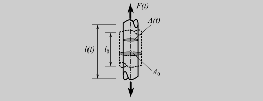
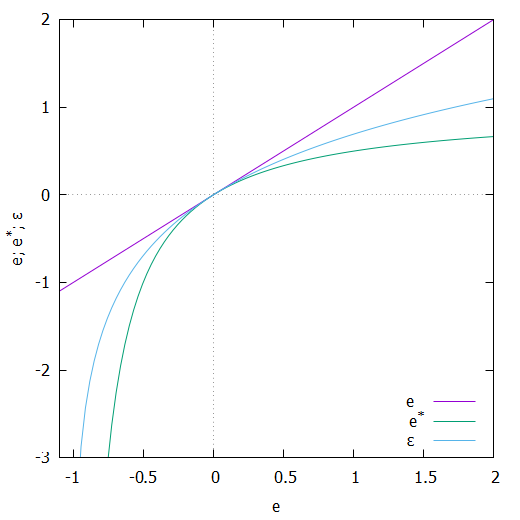

# Einleitung

## Ein paar Worte vorab
Im allgemeinen ist das Verhalten von Strukturen nichtlinear. in der Kontinuumsmechanik lassen sich
- nichtlineare Randbedinugungen
- nichtlineare Verformungen (im Allgemeinen gegeben, wenn große Verformungen betrachtet werden)
- nichtlineares Materialverhalten 
unterscheiden ([vgl. z.B. hier](https://ulwuttke.github.io/LMMD/01_linear/01_linear.html))

Die Linearität ist immer der Sonderfall, mit dem großen Vorteil der Möglichkeit der Superposition. Lastfälle können einzeln gerechnet werden und die Ergebniss im Nachgang beliebig kombiniert werden. Dies klappt bei der nichtlinearen Beschreibung nicht mehr. Daher sollten mach sich so lange wie möglich versuchen Dinge linear zu beschreiben. 

Ziel des Kurses ist es unterschiedliche Möglichkeiten der nichlinearen Materialmodellierung kennenzulernen und auf ein konkretes Beispiel anzuwenden:

Der Kurs beschänkt sich dabei auf homogene und isotrope Materialien.

## Einstieg in die Nichtlinearität 

### Spannugnsgrößen (eindimensional)

Betrachtet man einen einfachen Zugstab, so ist die Spannung als Kraft $F=F(t)$ durch die Querschnittsfläche definiert. In der klassischen Ingenieurwelt wird hier als Bezugsquerschnitt der Ausgangsquerschnitt $A_0$, also die undeformierte Struktur, verwendet. Die so berechneten Spannungen $\sigma$ werden auch als technische Spannungen $\sigma_tech$, oder - etwas exotischer - Piola-Kirchhoffsche- Spannugne $P$ bezeichnet:

$\sigma=\sigma_{tech}=P=\frac{F(t)}{A_0}$

Wird die Kraft nicht auf den Ausgangsquerschnitt $A_0$ sondern auf den aktuellen Querschnitt $A(t)$ bezogen ergeben sich die wahren Spannungen:

$\sigma=\sigma_{wahr}=\frac{F(t)}{A(t)}$

Für die Berechnung der wahren Spannung muss also die gesamte Verformung bekannt sein. Ein einfacher Ansatz ist vorauszusetzen, dass das Volumen des deformierten Stabes konstant bleibt, also das gilt 

$
\begin{eqnarray}
V_0&=&V(t)\\
l_0\cdot A_0&=&l(t)\cdot A(t)
\end{eqnarray}
$

$\Rightarrow A(t)=\frac{l_0}{l(t)}A_0=\frac{l_0}{l_0+\Delta l(t)}A_0=\frac{1}{1+e}A_0$

mit $e=\frac{\Delta l}{l_0}$ der technischen Dehnung (aufgrund des nächsten Abschnitts wird hier schon das Symbol $e$ anstatt $\epsilon$ verwendet).

Die wahre Spannung lässt sich also aus der technischen wie folgt berechnen:

$\sigma=\sigma_{wahr}=\frac{F(t)}{A(t)}=\frac{F(t)}{\frac{1}{1+e}A_0}=\frac{F(t)}{A_0}(1+e)=P(1+e)$

### Verformungsgrößen (eindimensional)

Betrachtet man die Verformung, bzw. die einachsigen Dehnungen, so lassen sich auch hier unterschiedliche Verformugnsmaße definieren:

- Technische Dehnung: $e=\frac{\Delta l}{l_0}$
- Dehnung, bezogen auf die Aktuelle Länge:  $e^*=\frac{\Delta l}{l(t)}=\frac{l_0}{l_0+\Delta l(t)}=\frac{e}{e+1}$
- Wahre Dehnung: $\epsilon=ln(1+e)

Die hier formulierte wahre oder logarythmische Dehnung ergibt sich, wenn man die Gesamtverformung in viele kleine Verformugnsanteile $\mathrm{d}l$ und bezieht diese auf die aktuelle Länge $l$ ergeben sich entsprechend kleine Dehnungsinkremente

$\mathrm{d}\epsilon=\frac{\mathrm{d}l}{l}$

Die gesamte Dehnung ergibt sich dann über das Aufsummieren dieser kleinen Dehnungsinkremente, also durch das Integral:

$\epsilon=\int_{l_0}^{l} \frac{1}{l}\, dl=ln(l)-ln(l_0)=ln(\frac{l}{l_0})=ln(1+\frac{\delta l}{l_0})=ln(1+e)$

Der Vergleich der unterschiedlichen Dehnungsmaße zeigt, dass diese sich für kleine Verformungen (Dehnungen um die Null) kaum unterscheiden. Erst mit größeren Verformungen treten deutliche Unterschiede auf. Letztlich ist es aber erst eimal egal, mit welchem Maß die Verformung/Dehnung beschrieben wird, da sich die unterscheidlichen Maße ja ineinander umrechnen lassen. 

