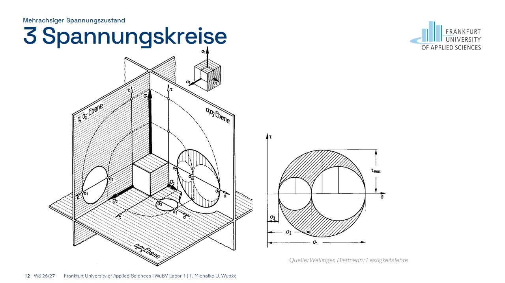
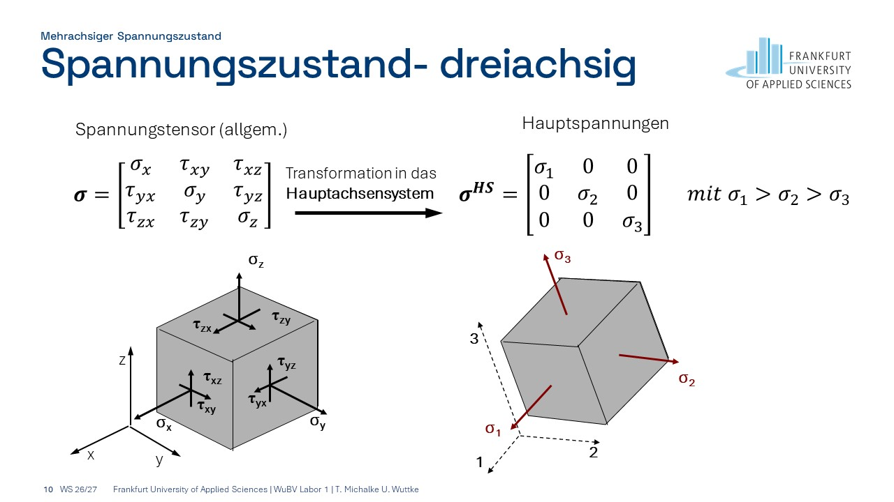
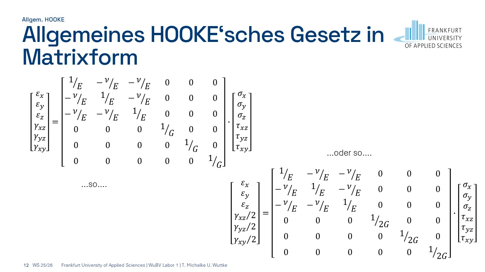

# Wiederholung

## Mohrscher Spannungskreis
Darstellung zur Veranschaulichung des Spannungszustandes. 

- [WIKIPEDIA](https://de.wikipedia.org/wiki/Mohrscher_Spannungskreis)
- [LMMD-Skript](https://ulwuttke.github.io/LMMD/02_rep/02_rep.html#generalized-hooke-s-law)

```{dropdown} ... oder zur Erinnerung aus dem Kurs WuBV an der FRA UAS

```

## Spannungstensor
Tensor, der die Spannungsgrößen zusammenfasst um den Spannungszustand eindeutig zu charakterisieren:

- [WIKIPEDIA](https://de.wikipedia.org/wiki/Spannungstensor)
- [LMMD-Skript](https://ulwuttke.github.io/LMMD/04_spten/04_spten.html)

```{dropdown} ... oder zur Erinnerung aus dem Kurs WuBV an der FRA UAS

```

## Linear elastisches Material

Klassische lineare Beschreibung (i.A. induktiv hergeleitet, vom Besonderen zum Allgemeinen):

- [WIKIPEDIA](https://de.wikipedia.org/wiki/Hookesches_Gesetz#Isotrope_Medien)
- [LMMD-Skript](https://ulwuttke.github.io/LMMD/02_rep/02_rep.html#generalized-hooke-s-law)

```{dropdown} ... oder zur Erinnerung aus dem Kurs WuBV an der FRA UAS

```

## Tensordarstellung/Tensorstufe/Indexschreibweise

- [WIKIPEDIA](https://de.wikipedia.org/wiki/Einsteinsche_Summenkonvention)
- [LMMD-Skript](https://ulwuttke.github.io/LMMD/03_vecten/03_vecten.html)


